<div align="center">

# 🎬 insta-studio

**An animated content studio for one Instagram + YouTube Shorts account, in any niche.**<br>
You bring an idea. [Claude Code](https://claude.com/claude-code) writes the script, draws every frame,
records the narrator and hands you a finished reel.


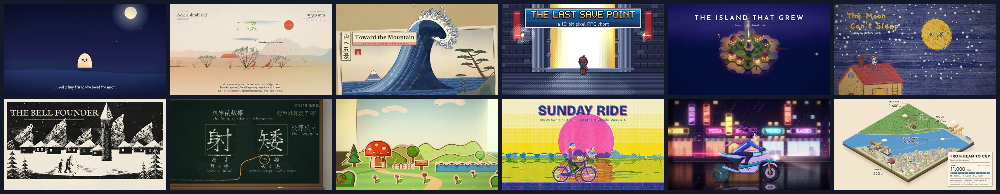

<sub>12 of the 67 looks a reel can take. Every frame is code: no presenter, no stock footage, no AI images.</sub>

**[🚀 First reel in an hour](first-time-setup-create-first-reel.md)** · **[🎨 All 67 styles](#-67-styles)** · **[⚙️ How it works](#%EF%B8%8F-how-it-works)**

</div>

---

## ✨ What you get

<table>
<tr>
<td width="33%" valign="top">
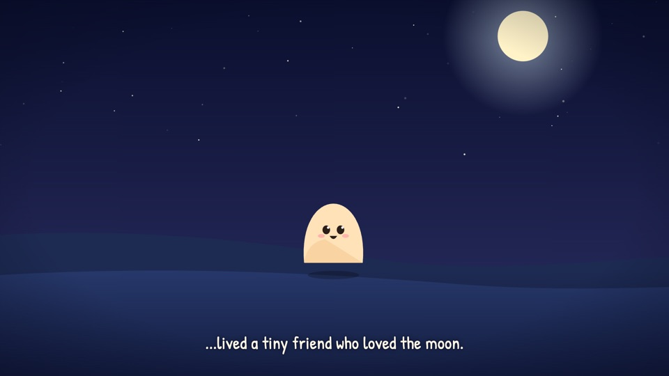<br>
<b>🎞️ 60-second reels</b><br>
<sub>One cartoon analogy world explains one idea. A narrator tells it, every beat lands on the spoken word, with music and soft effects. 9:16, ready for Reels and Shorts.</sub>
</td>
<td width="33%" valign="top">
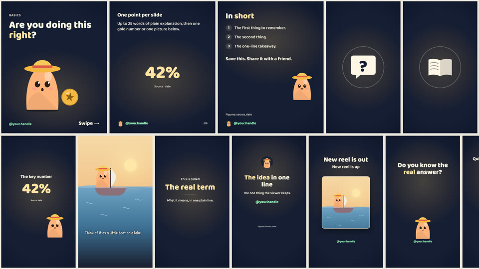<br>
<b>🖼️ Stills that match</b><br>
<sub>Carousels, single posts, story sets, highlight covers, designed reel covers, profile pictures and a YouTube banner, from one template library.</sub>
</td>
<td width="33%" valign="top">
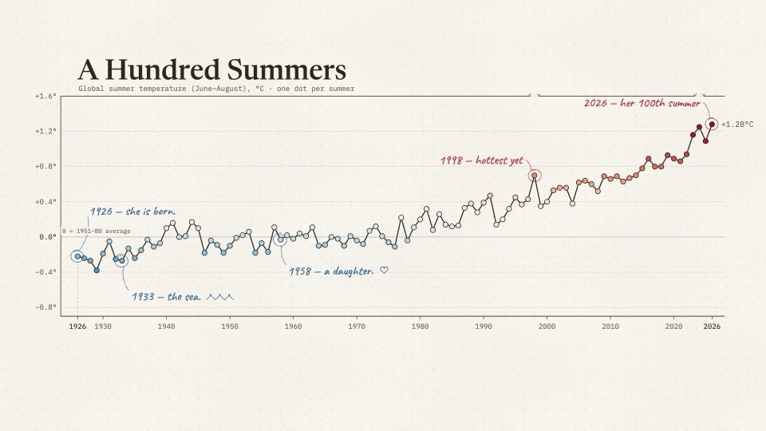<br>
<b>📝 Text that's ready to paste</b><br>
<sub>Instagram caption, Shorts title and description, plus a <code>sources.md</code> with a source and a date for every fact.</sub>
</td>
</tr>
</table>

Everything brand-specific (handle, colours, mascot, voice, disclaimer, hashtags, house styles) lives in
**`account.json`** and **`BRAND.md`**. Point the repo at a new niche and the same skills make content
for it.

## 🎨 67 styles

Every account picks a few **house styles** so the feed stays recognisable, and any reel can try another.
The house look is **Soft Storybook**. The other 66 come from
[lemo-opuscar](https://github.com/lemomo-ai/lemo-opuscar), each with a full guide to how it looks,
moves and sounds.

<table>
<tr>
<td width="33%"><a href="styles/watercolor/STYLE.md">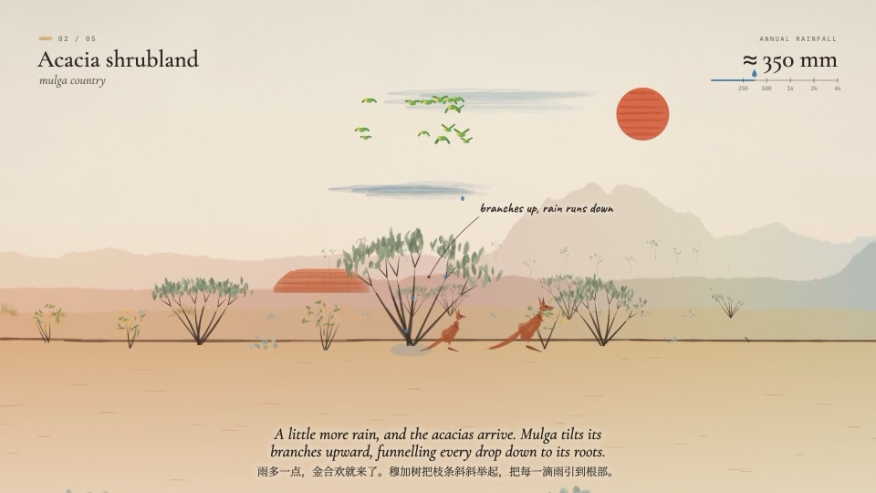</a><br><b>Watercolor Brush</b> · <code>watercolor</code></td>
<td width="33%"><a href="styles/ukiyoe/STYLE.md">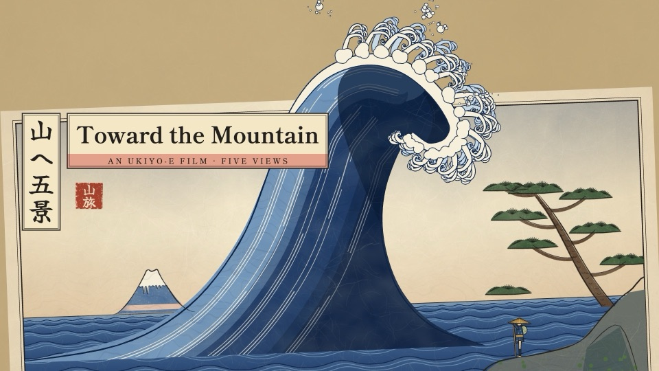</a><br><b>Ukiyo-e</b> · <code>ukiyoe</code></td>
<td width="33%"><a href="styles/pixel-rpg/STYLE.md">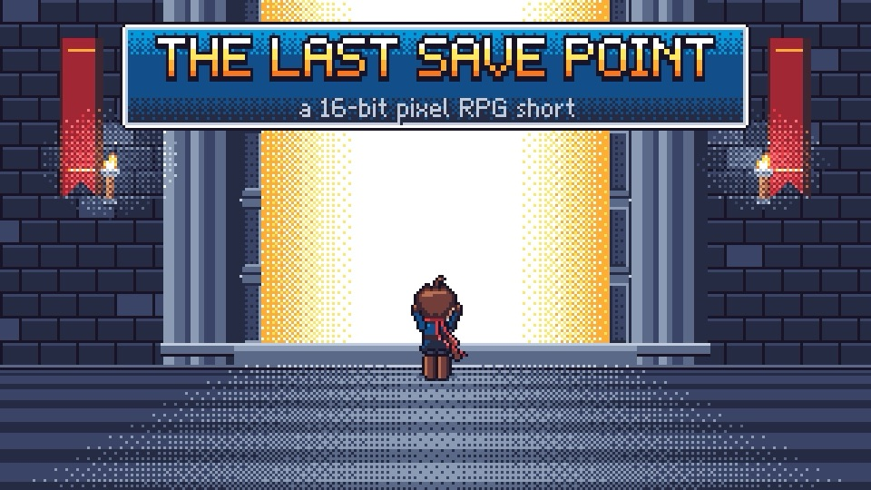</a><br><b>16-bit Pixel RPG</b> · <code>pixel-rpg</code></td>
</tr>
<tr>
<td><a href="styles/crayon-book/STYLE.md">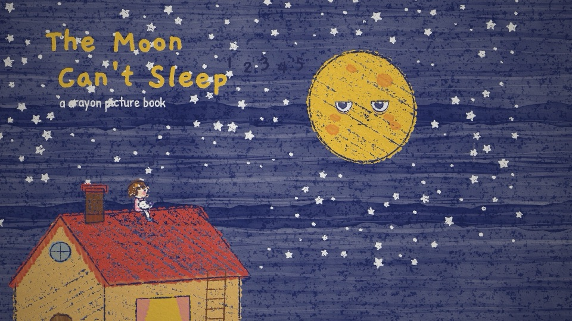</a><br><b>Crayon Picture Book</b> · <code>crayon-book</code></td>
<td><a href="styles/woodcut/STYLE.md">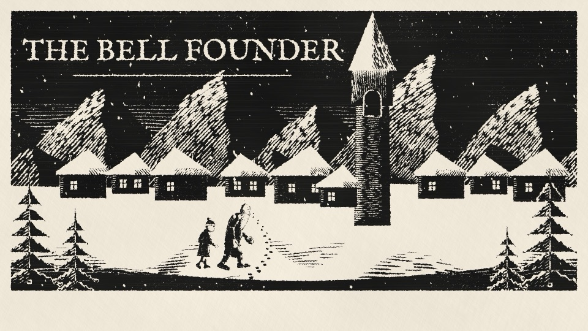</a><br><b>Woodcut Print</b> · <code>woodcut</code></td>
<td><a href="styles/lowpoly-island/STYLE.md">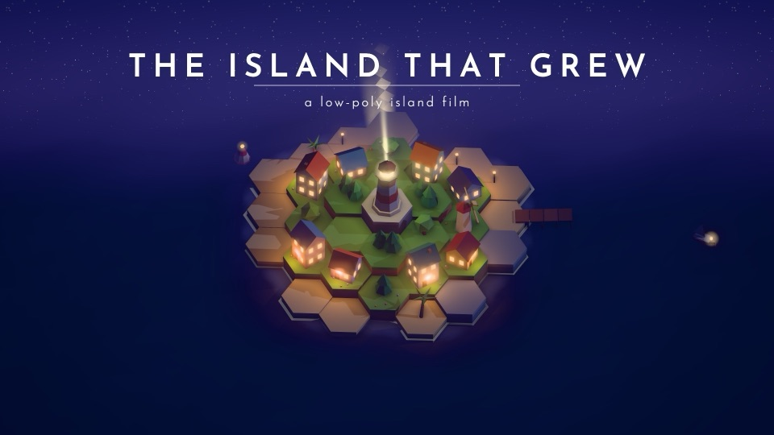</a><br><b>Low-poly Island</b> · <code>lowpoly-island</code> · 3D</td>
</tr>
<tr>
<td><a href="styles/chalkboard/STYLE.md">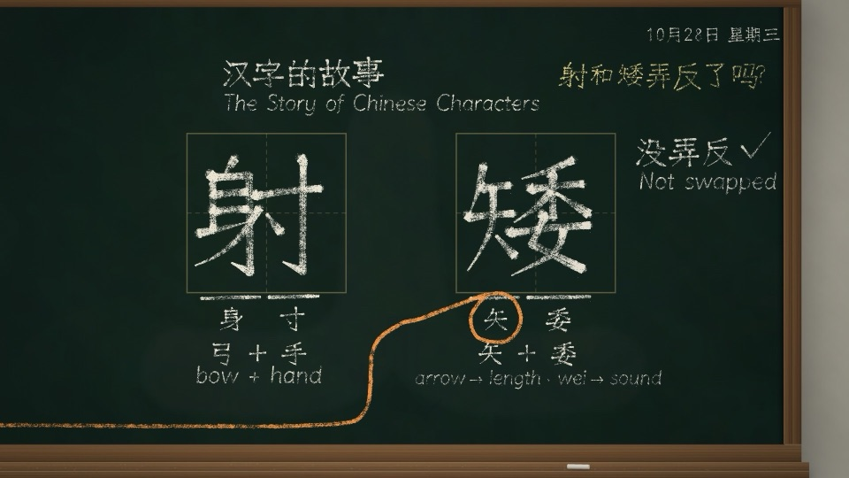</a><br><b>Chalkboard</b> · <code>chalkboard</code></td>
<td><a href="styles/risograph/STYLE.md">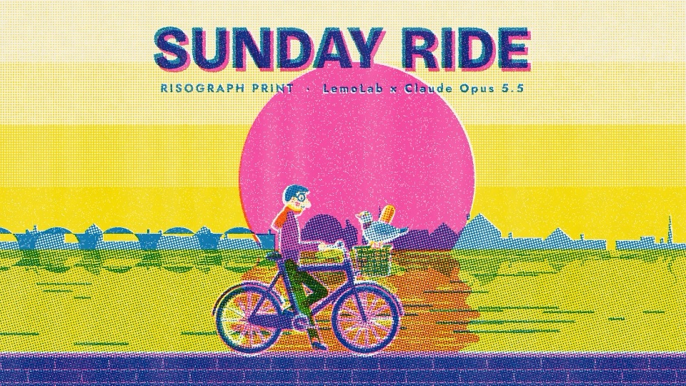</a><br><b>Risograph Print</b> · <code>risograph</code></td>
<td><a href="styles/iso-infographic/STYLE.md">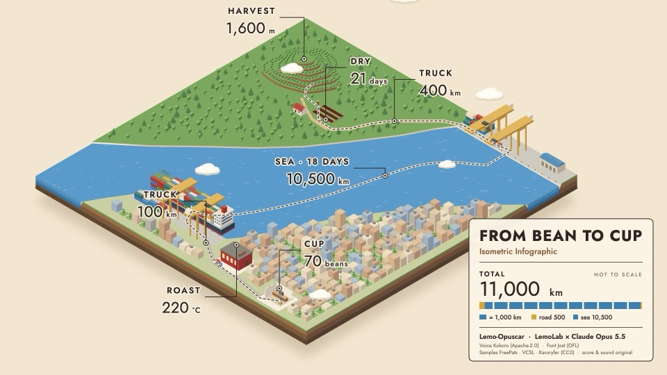</a><br><b>Isometric Infographic</b> · <code>iso-infographic</code></td>
</tr>
</table>

Just name one: *"make the next reel about compound interest in the **woodcut** style"*.

<details>
<summary><b>🗂️ See every style</b> (poster sheet and the full list by group)</summary>
<br>
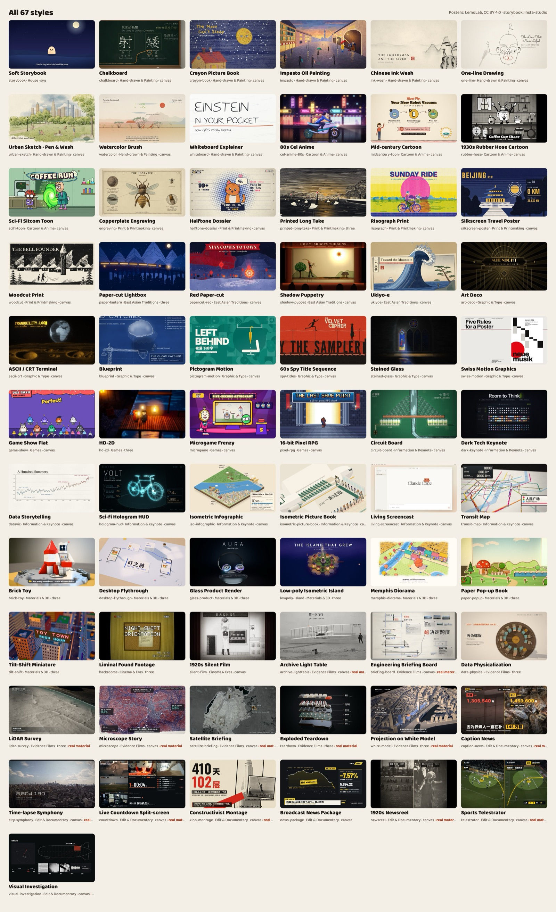

<!-- styles:start -->
<!-- generated by scripts/styles-index.mjs; do not edit by hand -->

| Group | Styles (folder name in brackets) |
|---|---|
| House | [Soft Storybook](styles/storybook/STYLE.md) (`storybook`) |
| Hand-drawn & Painting | [Chalkboard](styles/chalkboard/STYLE.md) (`chalkboard`) · [Crayon Picture Book](styles/crayon-book/STYLE.md) (`crayon-book`) · [Impasto Oil Painting](styles/impasto/STYLE.md) (`impasto`) · [Chinese Ink Wash](styles/ink-wash/STYLE.md) (`ink-wash`) · [One-line Drawing](styles/one-line/STYLE.md) (`one-line`) · [Urban Sketch · Pen & Wash](styles/urban-sketch/STYLE.md) (`urban-sketch`) · [Watercolor Brush](styles/watercolor/STYLE.md) (`watercolor`) · [Whiteboard Explainer](styles/whiteboard/STYLE.md) (`whiteboard`) |
| Cartoon & Anime | [80s Cel Anime](styles/cel-anime-80s/STYLE.md) (`cel-anime-80s`) · [Mid-century Cartoon](styles/midcentury-toon/STYLE.md) (`midcentury-toon`) · [1930s Rubber Hose Cartoon](styles/rubber-hose/STYLE.md) (`rubber-hose`) · [Sci-Fi Sitcom Toon](styles/scifi-toon/STYLE.md) (`scifi-toon`) |
| Print & Printmaking | [Copperplate Engraving](styles/engraving/STYLE.md) (`engraving`) · [Halftone Dossier](styles/halftone-dossier/STYLE.md) (`halftone-dossier`) · [Printed Long Take](styles/printed-long-take/STYLE.md) (`printed-long-take`) · [Risograph Print](styles/risograph/STYLE.md) (`risograph`) · [Silkscreen Travel Poster](styles/silkscreen-poster/STYLE.md) (`silkscreen-poster`) · [Woodcut Print](styles/woodcut/STYLE.md) (`woodcut`) |
| East Asian Traditions | [Paper-cut Lightbox](styles/paper-lantern/STYLE.md) (`paper-lantern`) · [Red Paper-cut](styles/papercut-red/STYLE.md) (`papercut-red`) · [Shadow Puppetry](styles/shadow-puppet/STYLE.md) (`shadow-puppet`) · [Ukiyo-e](styles/ukiyoe/STYLE.md) (`ukiyoe`) |
| Graphic & Type | [Art Deco](styles/art-deco/STYLE.md) (`art-deco`) · [ASCII / CRT Terminal](styles/ascii-crt/STYLE.md) (`ascii-crt`) · [Blueprint](styles/blueprint/STYLE.md) (`blueprint`) · [Pictogram Motion](styles/pictogram-motion/STYLE.md) (`pictogram-motion`) · [60s Spy Title Sequence](styles/spy-titles/STYLE.md) (`spy-titles`) · [Stained Glass](styles/stained-glass/STYLE.md) (`stained-glass`) · [Swiss Motion Graphics](styles/swiss-motion/STYLE.md) (`swiss-motion`) |
| Games | [Game Show Flat](styles/game-show/STYLE.md) (`game-show`) · [HD-2D](styles/hd-2d/STYLE.md) (`hd-2d`) · [Microgame Frenzy](styles/microgame/STYLE.md) (`microgame`) · [16-bit Pixel RPG](styles/pixel-rpg/STYLE.md) (`pixel-rpg`) |
| Information & Keynote | [Circuit Board](styles/circuit-board/STYLE.md) (`circuit-board`) · [Dark Tech Keynote](styles/dark-keynote/STYLE.md) (`dark-keynote`) · [Data Storytelling](styles/dataviz/STYLE.md) (`dataviz`) · [Sci-fi Hologram HUD](styles/hologram-hud/STYLE.md) (`hologram-hud`) · [Isometric Infographic](styles/iso-infographic/STYLE.md) (`iso-infographic`) · [Isometric Picture Book](styles/isometric-picture-book/STYLE.md) (`isometric-picture-book`) · [Living Screencast](styles/living-screencast/STYLE.md) (`living-screencast`) · [Transit Map](styles/transit-map/STYLE.md) (`transit-map`) |
| Materials & 3D | [Brick Toy](styles/brick-toy/STYLE.md) (`brick-toy`) · [Desktop Flythrough](styles/desktop-flythrough/STYLE.md) (`desktop-flythrough`) · [Glass Product Render](styles/glass-product/STYLE.md) (`glass-product`) · [Low-poly Isometric Island](styles/lowpoly-island/STYLE.md) (`lowpoly-island`) · [Memphis Diorama](styles/memphis-diorama/STYLE.md) (`memphis-diorama`) · [Paper Pop-up Book](styles/paper-popup/STYLE.md) (`paper-popup`) · [Tilt-Shift Miniature](styles/tilt-shift/STYLE.md) (`tilt-shift`) |
| Cinema & Eras | [Liminal Found Footage](styles/backrooms/STYLE.md) (`backrooms`) · [1920s Silent Film](styles/silent-film/STYLE.md) (`silent-film`) |
| Evidence Films | [Archive Light Table](styles/archive-lighttable/STYLE.md) (`archive-lighttable`) † · [Engineering Briefing Board](styles/briefing-board/STYLE.md) (`briefing-board`) † · [Data Physicalization](styles/data-physical/STYLE.md) (`data-physical`) · [LiDAR Survey](styles/lidar-survey/STYLE.md) (`lidar-survey`) † · [Microscope Story](styles/microscope/STYLE.md) (`microscope`) † · [Satellite Briefing](styles/satellite-briefing/STYLE.md) (`satellite-briefing`) † · [Exploded Teardown](styles/teardown/STYLE.md) (`teardown`) † · [Projection on White Model](styles/white-model/STYLE.md) (`white-model`) † |
| Edit & Documentary | [Caption News](styles/caption-news/STYLE.md) (`caption-news`) † · [Time-lapse Symphony](styles/city-symphony/STYLE.md) (`city-symphony`) † · [Live Countdown Split-screen](styles/countdown/STYLE.md) (`countdown`) † · [Constructivist Montage](styles/kino-montage/STYLE.md) (`kino-montage`) † · [Broadcast News Package](styles/news-package/STYLE.md) (`news-package`) · [1920s Newsreel](styles/newsreel/STYLE.md) (`newsreel`) † · [Sports Telestrator](styles/telestrator/STYLE.md) (`telestrator`) † · [Visual Investigation](styles/visual-investigation/STYLE.md) (`visual-investigation`) † |

† Needs real footage, photos, scans or data that you supply. Every other style is drawn entirely in code.
<!-- styles:end -->

More detail per style (renderer, fit notes for 9:16 reels): [`styles/README.md`](styles/README.md).
What every style keeps for your account (safe zones, subtitles, mascot, voice): [`styles/ADAPTING.md`](styles/ADAPTING.md).
</details>

## ⚙️ How it works

Three Claude Code skills ship with the repo (`.claude/skills/`). Each one stops for your OK before it
spends a single credit.

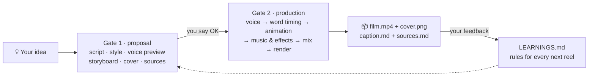

| Skill | Say | What happens |
|---|---|---|
| 🧭 `new-account` | *"set up a new account for plant care"* | Interviews you (niche, audience, handle, voice, mascot, colours, house styles, safety rules), fills `account.json` + `BRAND.md`, renders the brand kit, proposes your first 5 reels |
| 🎞️ `reel` | *"make the next reel about X"* | **Gate 1:** script, style options, voice preview, storyboard, cover and sources, no credits spent. **Gate 2:** voice, word timing, animation, mix, render, cover, captions |
| 🖼️ `social` | *"turn that reel into a carousel"* | Outline for your OK, then PNGs in `social/<slug>/` with `caption.md` and `sources.md` |

Rules that came from real feedback are built in: no presenter, hook first, designed covers, no sticker
placeholders, verified and dated facts. Your own feedback goes into `LEARNINGS.md` and becomes a rule
for every later piece.

## 🚀 Quick start

```bash
gh repo create my-account --private --template sohamthebuilder/insta-studio --clone
```

```bash
cd my-account && bash scripts/setup.sh
```

```bash
claude
```

Then say *"set up a new account for &lt;your niche&gt;"*. You need Node 18+, ffmpeg, Python 3 and
[ElevenLabs](https://elevenlabs.io) (connector or `ELEVENLABS_API_KEY`). A 60 s reel costs about
2,750 credits.

👉 The full walkthrough, from install to a posted reel: **[first-time-setup-create-first-reel.md](first-time-setup-create-first-reel.md)**

## 🧰 Handy commands

```bash
bash studio/render-brand.sh                     # re-render the brand kit after editing account.json
bash studio/render-piece.sh <slug> --guides     # check a post against the safe zones
bash scripts/new-reel.sh <slug> --style <style> # new reel project in a style (default: account.json)
bash studio/render-style-picker.sh [style ...]  # poster sheet to choose a look (no names = all 67)
bash scripts/fetch-style-demo.sh <style>        # a library style's upstream demo code, to read while porting
node scripts/styles-index.mjs                   # rebuild the style index and the list in this README
cd reels/<slug> && npm run studio               # preview a reel in the browser
cd reels/<slug> && npm run render               # render out/film.mp4
```

<details>
<summary><b>📁 Repo layout</b></summary>

```
account.json        brand values the code reads (handle, colours, mascot, voice, music, styles)
BRAND.md            brand guide: voice, 8-beat story formula, specs, captions, safety rules
LEARNINGS.md        owner feedback rules, newest last
LOG.md              every reel and post made
styles/             67 looks: <style>/STYLE.md (+ DEMO.md, style.json, poster.jpg), README.md (index),
                    ADAPTING.md (what every style keeps for this account), catalog.json (renderer, fit)
.claude/skills/     new-account, reel, social
engine/             the animation engine: ENGINE.md (pipeline), references/, template/ (with the
                    StyleCanvas bridge for canvas and three.js styles), scripts/, examples/
studio/             still-image templates (Remotion): src/brand (mascot, tokens, fonts),
                    src/templates (reel, carousel, story, highlight, banner, style picker), src/pieces
brand/              rendered brand kit: templates/template-sheet.png, assets/ (profile, avatar, banner)
reels/<slug>/       one Remotion project per reel   (scripts/new-reel.sh <slug>)
social/<slug>/      rendered posts and story sets
docs/               images for this README
```
</details>

## 🙏 Credits

Built from the story-animator pipeline. Fonts: Baloo 2 and Patrick Hand (Google Fonts, OFL).

The 66 library styles come from [lemo-opuscar](https://github.com/lemomo-ai/lemo-opuscar) by
**LemoLab**: style guides under MIT ([`styles/LICENSE-lemo-opuscar`](styles/LICENSE-lemo-opuscar)),
poster frames under CC BY 4.0 © LemoLab (resized, and combined into `docs/hero.jpg` and
`docs/all-styles.jpg`). Reels you make with them are yours.
